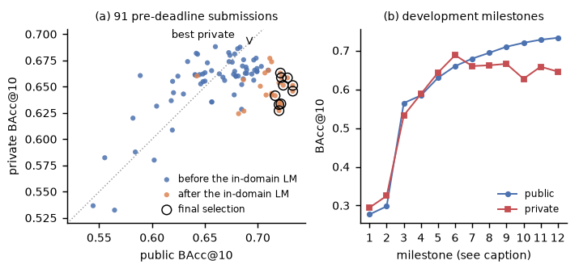

# MEG word decoding with sentence-level language priors (PNPL 2026, Deep Track)

This repository contains the code for team `yu_kuo14` in the [PNPL Competition 2026: Deep Track](https://www.kaggle.com/competitions/pnpl-competition-2026-deep). The task is to decode which of 50 common English words a single participant hears from MEG recordings. Submissions are scored by class-balanced top-10 accuracy (BAcc@10, chance = 0.20).

**Result:** public leaderboard 0.733 (13th of 91 teams); **private leaderboard 0.663 (44th)**. Kaggle rankings are provisional until the organisers' verification.

The late public gains did not transfer to the private split. Four large early changes kept the sign of their effect from public to private; only 10 of 26 later changes did. Among the 60 pre-deadline submissions with public score >= 0.66, the 24 from the last week averaged 0.714 public and 0.648 private, against 0.686 and 0.666 for the earlier ones. Our best private score (0.688) came from an earlier, simpler 9-model ensemble. The 92 isolated-word test rows appear not to be scored in either split.



The workshop write-up is [`paper/paper.pdf`](paper/paper.pdf) (LaTeX source in `paper/`). `analysis/` contains the Kaggle export of all 99 submissions with public and private scores, and the scripts that compute the leaderboard statistics, figures and tables of the write-up. Which inputs are annotated by hand is described in [`docs/REPRODUCE.md`](docs/REPRODUCE.md), Section 6.

## Pipeline

1. **MEG decoder.** A per-word CNN encoder followed by a sentence-level Transformer, after d'Ascoli et al. (2025). The ensemble has about 30 members, varying in window, sampling rate, depth, width and normalisation. Some members are self-trained on the unlabelled test recordings with soft targets.
2. **Closed-vocabulary LM fusion.** A causal LM scores the 50 words at each sentence position, using soft beam-prefix mixtures. Its PMI (LM log-probability minus the log of its average over test positions) is added to the MEG log-probabilities with α = 0.5. Public 0.584 → 0.630, private 0.588 → 0.643.
3. **In-domain LM.** GPT-2 is fine-tuned on synthetic sentences that use only the 50 words, written by Claude and by Qwen3.5-9B (see `corpora/`). On a fixed ensemble this gave +0.010 public (0.710 → 0.720) but −0.038 private (0.666 → 0.627).
4. **Whole-sentence candidate decoding.** Every candidate sentence of the right length is scored by its summed MEG log-probability plus 0.5 × the in-domain GPT-2 sentence log-probability. The resulting per-position marginals are mixed into the submission with λ = 0.3. Candidates include LLM proposals guided by our own top-6 words per position. This gave 0.724 → 0.733 public but 0.651 → 0.646 private; the ablations below show that the public gain was not reliable.

| Candidate-decoding ablation (base 0.724 / 0.651, λ = 0.3) | Public | Private |
|---|---|---|
| general pool, no LM prior | 0.721 | 0.662 |
| general pool, LM prior | 0.706 | 0.652 |
| guided pool, no LM prior | 0.708 | 0.644 |
| guided pool, LM prior (best public submission) | 0.733 | 0.646 |
| guided pool, LM prior only (no MEG term) | 0.708 | 0.624 |

## Repository layout

```
experiments/20261008_full_subj0_deepnet/sources/   code (run from experiments/20261008_full_subj0_deepnet/)
  download_subj0.py, preprocess.py, preprocess_w3.py  data download and PCA epochs (1 s / 3 s windows)
  train.py, train_ctx.py                               MEG models (CNN + sentence Transformer)
  pseudo_ft.py, teacher_W.csv, teacher_P1.csv          self-training on the test recordings
  lm_fusion.py, lm_calib.py, make_final.py             LM fusion and submission assembly
  vocab_corpus.py, gen_vocab_llm.py, ft_vocab_lm.py    in-domain corpus and LM
  gen_guided.py, sent_cand.py                          whole-sentence candidate decoding
corpora/           vocabulary-only sentence corpora used for the LMs and candidates
analysis/          analyze_lb.py, make_tables.py, iso_check.py and their inputs and outputs (data/)
paper/             workshop write-up (PDF and LaTeX source)
docs/REPRODUCE.md  data, preprocessing, ensemble members, checkpoints, the best submissions, and the analysis
requirements.txt   package versions
```

The scripts expect the competition data under `data/raw/` at the repository root, and they write to `experiments/20261008_full_subj0_deepnet/outputs/`. Neither folder is tracked. `docs/REPRODUCE.md`, Section 1, lists the downloads.

## Notes

- No labels of the test set, cross-track metadata or timing leaks are used. Self-training and guided proposals use only our own predictions.
- Model checkpoints and fine-tuned LMs are on [Google Drive](https://drive.google.com/drive/folders/1HIGSl6Yx3K_mzwb7Op_ZBc0fdD9w8FNT); see `docs/REPRODUCE.md`, Section 5.

## License

MIT (code). The corpora in `corpora/` were generated for this project and are released under the same license. The competition data is not included; see the competition's own terms.
